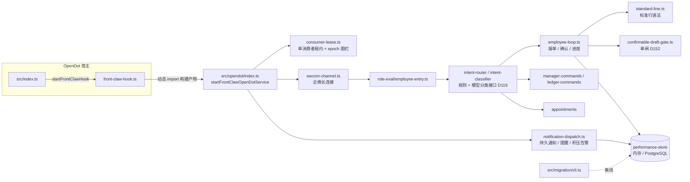

# 架构

## 1. 目标与约束

- 把 Front Claw 迁进 OpenDot，**复用旧代码**，不重写业务。
- OpenDot 侧改动尽量小：只加一个挂点文件，`src/index.ts` 改三处（`integrations/opendot-front-claw/opendot-hook.patch`）。
- 企微智能机器人**长连接**（`@wecom/aibot-node-sdk`）和 **PG 业绩账本**由 Front Claw 自己持有，不复用 OpenDot 的 channel_accounts、任务调度和 Mem0。
- **Mem0 关闭**：`FRONT_CLAW_MEM0` 只允许不设或 `0`，否则拒绝启动（`src/opendot/mem0-off.ts`）。
- 默认全关：`FRONT_CLAW_OPENDOT_ADAPTER=1` 之外的任何值都不读其他变量、不开库、不连企微。启动失败只记 warn，不影响 OpenDot 本身。

## 2. 组件

| 模块 | 职责 |
|---|---|
| `src/opendot/adapter.ts` | 把通道消息转成一轮业务处理；操作 ID 为 `front-claw:` + 40 位十六进制，不与 OpenDot `goal-run:` 冲突 |
| `src/opendot/consumer-lease.ts` | `performance_config` 中的一行作租约（30 秒，10 秒续约），带单调 `epoch`。每条消息处理前、回复前都核对；入账事务内 `FOR SHARE` 核对，旧持有者既不写也不回 |
| `src/opendot/host-contract.ts` | 对 OpenDot 宿主的最小契约（logger、env、关闭钩子） |
| `src/role-eval/access-policy.ts` | 分层授权：企业 → 门店 → 角色 → 个人 capabilities；每一步都重新判权（M03） |
| `src/role-eval/employee-entry.ts` / `employee-loop.ts` | 员工私聊入口：报单、确认、改账、进度查询、复合请求 |
| `src/role-eval/standard-line.ts` | 唯一一份标准行语法：「客户：金额（员工）」及其变体、归属说法、行尾备注 |
| `src/role-eval/confirmable-draft-gate.ts` | 门② 单闸：可确认草稿只能从这里放行（纯标准行或线上模型分类结果）；离线桩永远不放行 |
| `src/role-eval/amount-guard.ts` / `money.ts` | 金额解析与模糊金额检测；以分为单位 |
| `src/role-eval/customer-name-policy.ts` | 客户名策略 A/B/C（D139/D140），本店已确认名单 |
| `src/role-eval/performance-postgres.ts` | PG 账本；`010_front_claw_source_draft` 唯一约束保证不重复入账 |
| `src/role-eval/notification-dispatch.ts` | 通知领取、派发、重试，状态可恢复（M06） |
| `src/migration/*` | 两库迁移与回退（M08），默认 dry-run |

## 3. 一条报单的链路

1. 企微长连接收到私聊 → 适配器核对租约 → 员工入口识别身份、门店、角色。
2. 意图路由：标准行走**快通道**；不是纯标准行的，整句交给模型分类接口（离线用桩，桩一律先问）。
3. 标准行解析出条目 → 依次过 D81（只认今天）、跨店、权限、D133 归属、D130 备注白名单、D131 同日重复、D139 新客户 → **单闸**。
4. 放行后生成待确认草稿（显示「客户：X」一行），员工回「对」。
5. 确认是带条件的状态迁移（D151）：只有本次把 pending/confirming 改成 confirmed 才回「已入账」；否则回「已经处理过了」。
6. 草稿过期自动作废（D143）；入账后触发店长提醒等持久通知。

## 4. 数据

- PG 表结构：`migrations/007_front_claw_perf.sql`（基线）、`008`（通知投递列与到期索引）、`009`（金额精度）、`010`（草稿来源唯一约束），都带 down。
- 迁移版本表 + 校验和 + advisory lock，参考 golang-migrate / Flyway。
- 迁移工具只从 env 读连接串，不打印、不落盘；含共享库名的 URL、源等于目标都会被拒绝（`src/migration/guards.ts`）。

## 5. 部署边界（尚未执行）

- 目标：全部服务统一放到腾讯云，原有服务下线后从头部署（hanyu 11-12 20:11 定）。
- 凭据放在仓库外、权限 600 的只读文件里，业务账号和迁移账号分开（D46）。
- 以上都需要 hanyu 本人逐项批准，见 [../plan/approvals.md](../plan/approvals.md)。

## 6. 背景资料

`background-20261110/` 是 11-10 两份视角的架构整理（助手A与助手B），描述的是迁移前旧版现场试点的工程与产品架构。其中服务器路径和容器名已替换为占位符。
