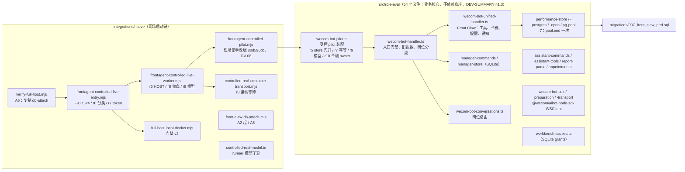
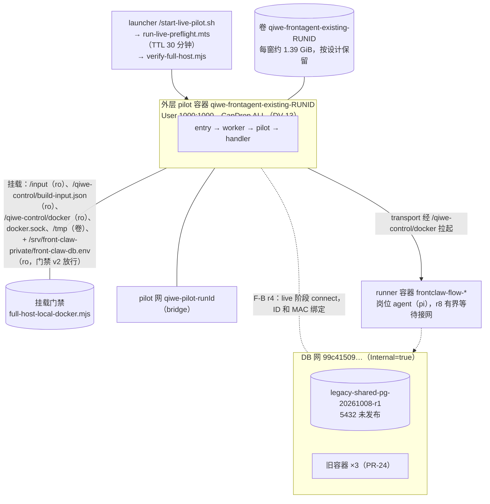
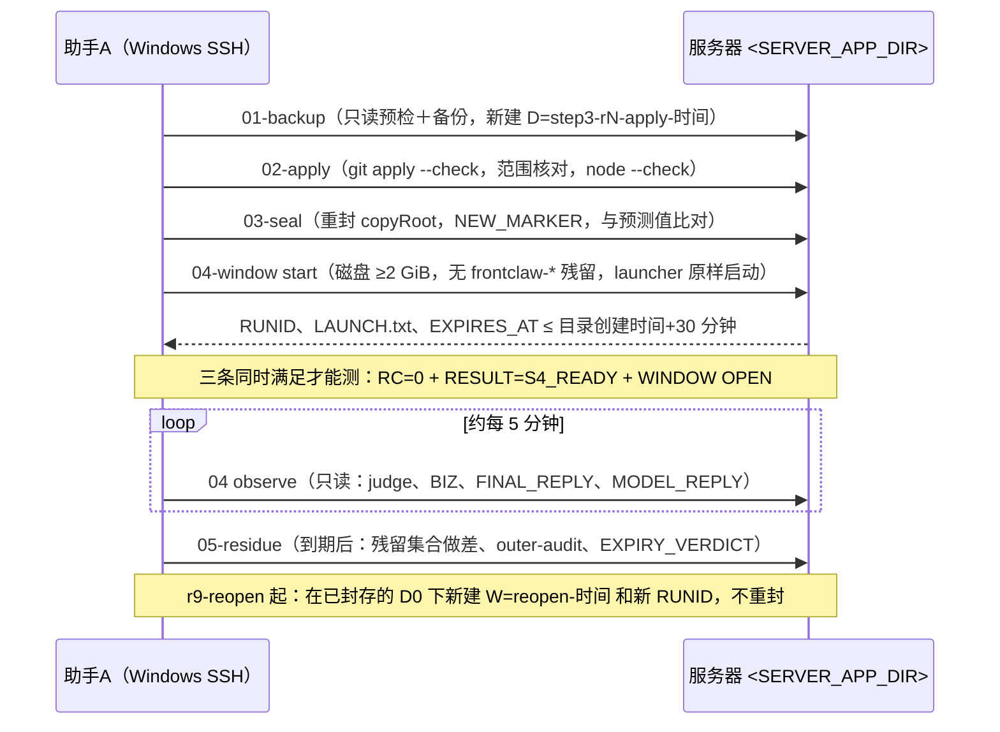
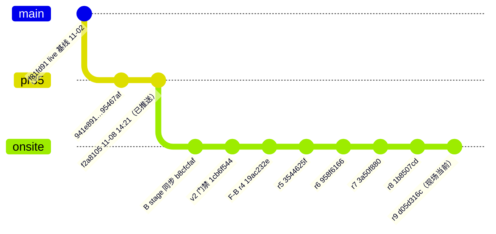

# Front Claw 工程架构（助手A侧，ENG-ARCH.md）

> 编写：2026-11-10 北京时间（UTC+8）。只读整理：没有连服务器，没有读 env 或凭据内容（文中只出现路径），没有提交。
>
> **依据**
> - 仓库版源码：`<本地路径>`（HEAD `f2a8105`，工作区干净）。
> - 补丁：`E/step3-fix-*`。
> - 现场日志：`E/step3r*-live-*`、`E/step4A-live-20261110`。
> - 登记：`E/issue-register-20261110/`（PR-xx、DV-xx）。
> - 开发总结：`E/dev-summary-20261110/CODE-CHANGES.md`（编号 A1–J）、`DEV-SUMMARY.md`（助手B）。
>
> 简写 `E/` = `<证据目录>/`。标注：**已证实** / **推断** / **未找到证据**。

---

## 1. 版本演进（工程视角）

| 版本 | 时间（北京时间） | 改变的工程部分 | 为什么 | 现在在哪里 |
|---|---|---|---|---|
| 仓库前史（43 个提交，`2590fa5`→`f81fd91`） | 10-17 → 11-02 22:43 | Native 宿主、真实 Docker transport、受控 pilot、full-host 验证链 | 建底座 | 仓库（`live/front-claw-20261102`） |
| PR35 前 5 个提交（`941e891`…`95467af`） | 11-02 22:09 → 11-03 17:03 | `src/role-eval` 统一 handler；`migrations/007_front_claw_perf.sql`；`pg-pool.ts`、`front-claw-boot.ts`、`directory-store.ts`；live-entry 和 worker 接 DB | PG 账本 | 仓库（PR35） |
| A1–A5 补丁 | 11-07 18:14 → 11-08 13:58 | store 端口绑定、预算 `STORE_RESULT_BUDGET_MS=15000`、claim/confirming 事务、预约事务、通知状态；新增 `front-claw-db-attach.mjs` | 幂等和可恢复 | 并入 f2a8105（推断） |
| A6 → **f2a8105** | 11-08 14:21 | `verify-full-host.mjs` 把 db-attach 复制进 test-support；`--env-file` 由 entry 进程里的 Docker **CLI 客户端**读取 | 现场入口不对、env 语义写错 | **仓库，已推送，未合并** |
| 现场 stage 同步（B） | 11-08 15:15 | 26 个文件进 copyRoot，seal/verify 61992，marker `dd8f43e8→b8cfcfaf` | 对齐现场版本 | 仅现场 |
| 门禁 v0 / v1 / v2 | 11-08 15:37 → 22:0x | `full-host-local-docker.mjs`：接受「5 挂载」或「精确 6 挂载（加只读 DB env）」，严格 0600、1000:1000 | run 14d9a83c 报 BOUNDARY_UNVERIFIED（DV-03） | **只有补丁**（`01e154db…`），没提交 |
| 申请 v1 / v2 / v3 / **v4** | v1 11-08 22:00、v2 22:08、v3 22:12（预检 node 127）、v4 11-09 14:47，15:2x 起执行 | 打进现场 A/B，新 marker `1cb6f544` | v3 时 PATH 里没有 node（DV-01），v4 改用 Node 22.23.2 绝对路径 | 仅现场 |
| F-B r1/r2 → r3 → r4 | 11-09 18:37 / 19:07 / 19:19，22:42 apply | 外层容器在 live 阶段**双网**（pilot 网加固定 DB 网），绑定 ID 和 MAC；docker CLI 固定路径，冻结 argv，空 env | run 0020232f 单网校验失败（DV-05）；env 注入风险（DV-14） | 现场（marker `19ac232e`），没提交 |
| r4 现场脚本包 | 11-09 20:35–22:40 | 01–05 五段式，RUNID 绑定，严格 30 分钟，noclobber | 现场操作要能审计 | 现场和本机 |
| r5 | 11-09 23:0x | 先开 store 再连企微；worker 注入 `FRONT_CLAW_DATABASE_HOST` | 构造期抛 `_URL` | 现场 `3544625f` |
| r6 | 11-10 00:xx | 把 `pg` 及依赖 vendor 进 `stage/app/node_modules`；`classifyOriginalError` | 缺 pg（DV-06）；错误被统一脱敏（DV-24） | 现场 `958f6166` |
| r7 | 11-10 13:18 后 | close 和 `pool.end` 幂等；加入到期 token | 正常到期被判失败（DV-07） | 现场 `3a50f880` |
| r8 | 11-10 14:xx | transport 有界等待接网，slot 一定释放，runner 失败兜底，`final_delivery`；磁盘门槛 3→2 GiB | 接网竞态（DV-05） | 现场 `1b8507cd` |
| r9 | 11-10 16:xx | `createFrontClawModel`（deepseek-flash） | 进程内用的是桩模型（DV-20） | 现场 **`d05d316c`（当前）** |
| r9-reopen | 11-10 18:3x | `04-reopen-window.sh` / `05-reopen-residue.sh`，子目录 W | 同一个 D 不能重开（DV-23） | 现场和本机 |
| step4 | 11-10 20:56 | `07-pg-counts.sh`（只读计数） | 21 项验收 | 现场和本机 |
| r10 草稿 | 11-10 17:40 后 | `frontClawOwnerIds` 包住 `remember` | owner 映射 | **只有补丁草稿** |

## 2. 代码结构（仓库 `<PRIVATE_ORG>/qiwe-agent`）

- 测试：`tests/role-eval/*`（vitest）和 `integrations/native/*.test.mjs`（node --test）。r9 的本机测试是 130 例：129 通过，1 跳过（CODE-CHANGES §G）。
- `src/role-eval` 约 51 个业务文件、6000 行，不引用底座的 `../`。这是 11-06 对照 OpenDot 时的结论，**仅转引**，见 DEV-SUMMARY §1.3。

## 3. 企微智能机器人长连接通道
- **SDK**：`@wecom/aibot-node-sdk` 的 `WSClient`。这是一条 WebSocket 长连接，**不是 HTTP 回调**（`wecom-bot-sdk.ts:2`、`wecom-bot-preparation.ts:1`，已证实）。
- **受控真实适配器**：`createControlledRealBotSdkAdapter({mode:'controlled-real-pilot', botId, corpId, memberId, admit})`（`wecom-bot-sdk.ts:21`）。只接纳窗口内、已绑定的成员，接纳后记一次 `request_admitted`。
- **连接顺序**：r5 以后是先打开 store，再 `owner.prepare()` 连企微。r5 之前在构造期就抛错，连上后立刻断开，企微日志里那句「Client not connected」只是连带结果（DV-06）。
- **回复路径**：
  - Front Claw 在进程内**同步**回复，预算 15 s；
  - 岗位对话先回 ack「收到，正在处理」，runner 完成后再**异步**发最终回复（PR-15）。
  - r8 起 `final_delivery` 和 `FINAL_REPLY` 计数；runner 失败时用 `notifyFailure` 兜底，每条 ≤200 字、10 s 超时。
- **缺口**：
  - 心跳和 connected 字段没有打印，r9 首窗零流量时分不清是没人发还是没收到（DV-22）；
  - 推送和回复没有逐条日志（DV-29、PR-13、PR-17）；
  - 迁移计划里企微**保留 SDK 长连接**；改成 OpenDot 的 IMChannel 要等备案和可信域名（`<本地路径>`）。

## 4. 容器、网络与挂载门禁

- **门禁规则**（`full-host-local-docker.mjs`）：
  - 挂载集合必须**精确**等于 5 个，或加上那个只读 env bind 共 6 个（v2）；
  - `volume.Options` 为空（DV-04）；
  - pilot 网必须是 `qiwe-pilot-<runId>` 的 bridge；
  - observe 阶段只允许单网，live 阶段在 F-B r4 下允许「固定 DB 网＋pilot 网」双网，网卡必须恰好是 eth0、eth1、lo。
- **env 文件**：`/srv/front-claw-private/front-claw-db.env`，1000:1000，权限 600，经用户批准用 sudo 改过属组（DV-12）。内容**没读过**。entry 里的 Docker CLI 以 `--env-file` 读它（A6）。
- **模型凭据文件**：只知道路径 `QIWE_PILOT_PRIVATE_FILE → /srv/front-claw-private/qiwe-live-pilot.private.json`，内容没读。
- **风险**：
  - 外层进 DB 网后能访问全部成员，不只是 PG（F-B r4 的 P2，PR-24）；
  - 外层容器里能直接用 docker.sock，这是既有能力（F-B r3 报告 §7）；
  - 端点只做即时一致性检查，有 TOCTOU 风险。

## 5. 数据：PG 和旧 SQLite

| | PG（Front Claw） | SQLite（旧） |
|---|---|---|
| 内容 | schema `front_claw_perf`，10 张表（`007_front_claw_perf.sql`） | ManagerStore 报数（推断 `manager/reports.sqlite`）；workbench grants；底座会话和 router_state（schema 69） |
| 打开方式 | 外层 pilot 进程 `openPerformanceStore` → `new Pool` → migrate（F-B 报告 §2）；r6 起依赖 vendored pg 8.13.1 | 进程内的 `node:sqlite`（`workbench-access.ts:1`） |
| 现场位置 | 容器 `legacy-shared-pg-20261008-r1`，库 `legacy_appointment_db`；数据在 bind 目录 `<SERVER_DATA_DIR>/synthetic-pg-r1/data`（**永不删除**） | 每个窗口的运行卷（推断；20:50 删卷时可能一起丢了，DV-19） |
| 问题 | 和旧容器共用 DB 网（PR-24）；测试数据写进共用库（PR-18） | 两套账本（PR-09） |

## 6. 模型调用
- **runner（岗位 agent）**：`controlled-real-model.ts` 做守卫，请求 `https://api.deepseek.com/anthropic/v1/messages`，模型 `deepseek-flash`。entry 会校验 baseUrl 和 model 字面量（CHANGES-r9，已证实）。
- **Front Claw 进程内（r9）**：
  - `createFrontClawModel` 复用 worker 的 `readModelCredentials()`，每次调用都现读 key，key 只放在请求头；
  - `temperature` 0.3，`max_tokens` 512；超时 min(12 s, 剩余预算−1 s)；
  - 工具取 `toolsFor(tier)` 和已知工具的交集，模型返回不在集合里的工具一律丢弃；
  - 失败分 10 类，统一回「处理失败，请稍后重试。」；
  - 日志只有 `FRONT_CLAW_MODEL_CALL_OK` 或 `…FAILED_<类别>`。
- **报数抽取**：`createModelReportExtractor`（`wecom-bot-report-model.ts`）走同一个端点。
- **现场实证**：reopen 窗口 933a41ed 和窗口 A b58d72d3 都是 `MODEL_REPLY source=real:deepseek-flash calls=1 ok=1`。
- **缺口**：一次模型失败会让 observe STOP（PR-16、DV-21）；费用没有监控；出网范围没审计（DV-09、PR-21）。

## 7. 部署、封存与窗口机制

- **copyRoot**：`<SERVER_APP_DIR>/frontagent-r3-20261029/input`，marker 文件是 `.qiwe-linux-stage.json`。verify 依赖 Node 22.23.2 的 `localeCompare` 排序（DV-02）。
- **RUNID 与卷**：每个窗口一个 uuid RUNID 和一个卷 `qiwe-frontagent-existing-<RUNID>`，按设计保留，删除要逐个 RUNID 由用户批准（DV-17、PR-20）。目前还剩窗口 A 的卷 b58d72d3 待批。
- **安全门**：路径准入 `adm`；`noclobber`，任何输出都不覆盖；不 source；PID 身份四项核对；失败只报不修。现场全程不读 env、不用 sudo、不删数据。
- **各窗口结果**：

| 窗口 | 时间 | 结果 |
|---|---|---|
| r4 e7be7b70 | 11-09 22:43 | 没有 READY |
| r5 ffdd5ee9 | 23:56 | 没有 READY |
| r6 26e0d23c | 11-10 00:53 | READY，但到期误报 |
| r7 0fd35464 | 约 14:0x | 到期干净，runner 接网失败 |
| r8 3704c8fb | 15:09 | 通过，admitted 4，最终回复 3 |
| r9 6d2c609d | 17:43 | 零流量 |
| reopen 933a41ed | 18:50 | ok=1 |
| step4A b58d72d3 | 21:04 | admitted 13，最终回复 6，CLEAN |

## 8. 现场和仓库的分叉（d05d316c 对 f2a8105）

> 上图的 onsite 分支是**示意**。现场没有 git 提交，每一步都是补丁加 seal marker。

- 现场比仓库多出：门禁 v2（2 个文件）、F-B r4（7 个文件）、r5–r9（role-eval 里的 `wecom-bot-pilot.ts`、`performance-open.ts`，以及 native 下的 entry、worker、pilot、transport 和测试）、vendored pg（119 个文件）。
- 现场的 `frontagent-controlled-pilot.mjs` 本来就是**来源不明的多角色手改版 80d590dc**，带 `.bak-multirole`，不等于 f2a8105 的 529e8a01。r5 以后按用户要求保留（DV-08）。
- **迁移的取法**：以现场 marker d05d316c 的文件清单为准，把可复用的修复（r5–r9、v2 的思路）整理成提交，或者在 OpenDot 上重新实现。r4 entry 里硬编码的 CLI 路径和网络 ID、01–05 脚本、vendored pg 都属于试点脚手架，应该丢掉或重做（DEV-SUMMARY §4.2）。

## 9. OpenDot 集成点（计划，都还**没执行**）
OpenDot 在本机上的副本是 `<本地路径>`（helsome/OpenDot）。README 写的是：复用 Pi Agent Runtime、Goal、群聊、工具授权、记忆边界。

| 集成点 | 现状 | 计划做法 | 依据 |
|---|---|---|---|
| 业务核心 `src/role-eval` | 不依赖底座 | 原样搬过去；约 55 个测试作为回归 | DEV-SUMMARY §1.3（转引） |
| 对话 schema | 底座 69 | 锚点改到 107，先在副本 SQLite 上迁移验证 | plan.txt |
| 执行准入 | 旧的 `business-execution-admission/policy` | 新底座已经删掉了，用薄适配层代替 | plan.txt |
| 任务领取 | native-bot-execution/tasks 自己调度 | 门店任务只由自己的调度领取，OpenDot goal-run 不领；双调度并跑时每个任务只执行一次 | plan.txt |
| 企微通道 | SDK 长连接 | 先保留；IMChannel 要等备案 | plan.txt |
| 账本 | PG `front_claw_perf` 加旧 SQLite | 只用 PG（PR-09） | plan.txt、PRODUCT-ARCH §4 |
| 记忆 | Mem0 还没下线 | 默认关；证明门店员工隔离之前，不写客户隐私（PR-22） | plan.txt、`E/mem0-decom-plan-20261110/PLAN.md` |
| 放行门槛 | — | 21 项全过；影子回放（副作用要隔离）；回滚要保证业务一致；用户批准才切换 | plan.txt、review.txt、PLANS 第 5–7 步 |

## 10. 证据缺口
- r7 现场 01–05 日志：**未找到证据**，r7 窗口的时间是按 r8 RUNBOOK 和 14:46 删卷推算的（推断）。
- 心跳、connected 字段，以及逐条的投递时间：**未找到证据**（DV-22、DV-29）。
- 旧 SQLite 账本的实际路径：**未找到证据**（DV-19）。
- 「ubuntu 就是 uid 1000」：只核到属主为 1000，运行时的实际 uid **没核实**（DV-13）。
- OpenDot 侧的适配层代码：**还不存在**；画布 `af62fd39-…` 这次没打开。
