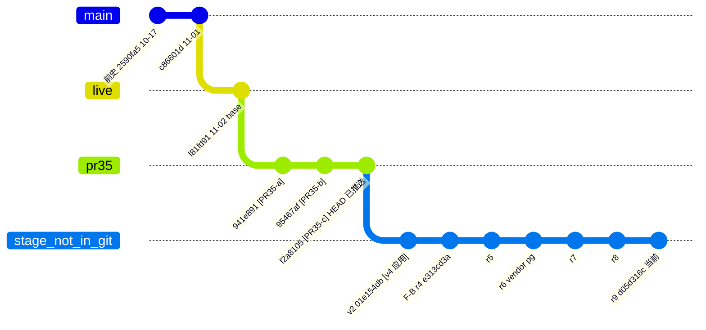
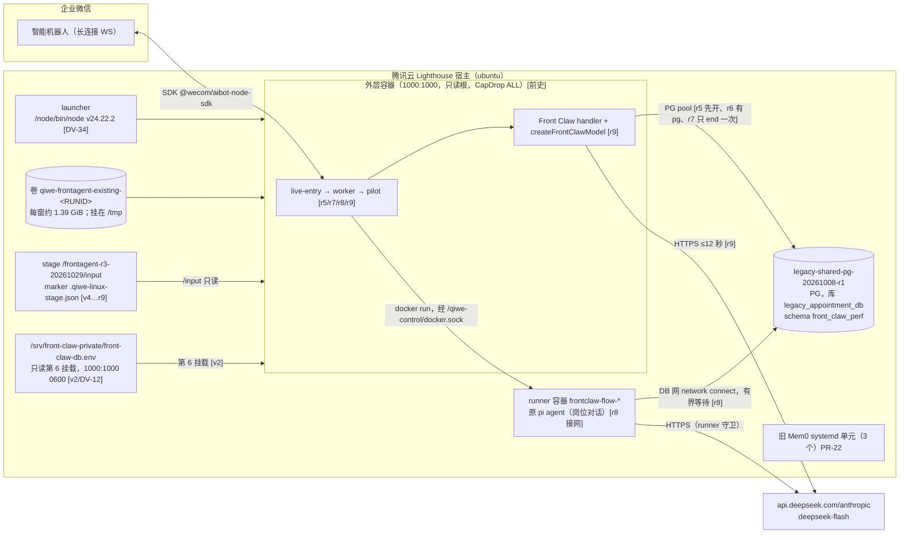
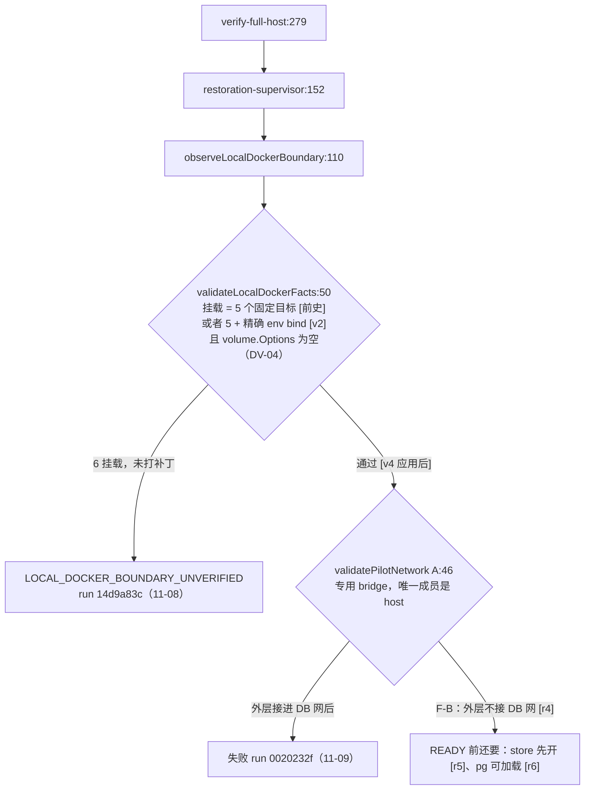
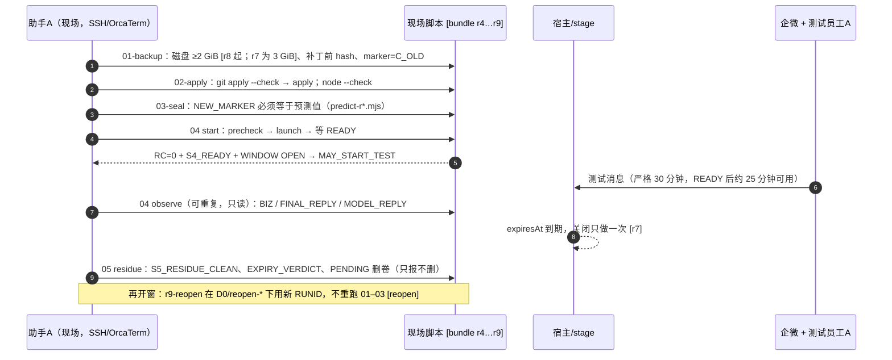
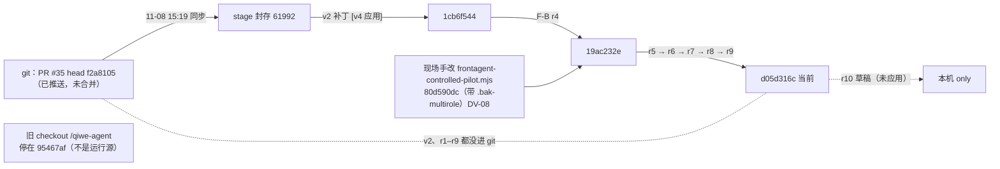

# Front Claw 工程架构（助手B视角，截至 2026-11-10 22:15 UTC+8）

> 依据：用户 22:09 原话「还有产品架构和工程架构呢」「你和助手B都要」，22:10 原话「把每个版本迭代这两份也要标记出来」，均由助手A转述。
> 只读：没连服务器、没读 env、没用 sudo、没改已有文件、没提交、没开窗。时间为北京时间（UTC+8）。
> 简写：`E/` = `<证据目录>/`；`R/` = `<本地路径>`（f2a8105 只读浅克隆）；**stage** = 现场 `<SERVER_APP_DIR>/frontagent-r3-20261029/input`。
> 来源标签：【文件】【GitHub】【会话记录】【仅记忆】【推断】【无证据】。问题编号用 issue-register 现版（tgz `4b403fb9…`）。服务器地址一律不写。

---

## 1. 版本演进表（工程视角）

| 版本 | 时间（UTC+8） | 架构哪部分变了 | 为什么变 | 现在在哪 |
|---|---|---|---|---|
| **前史** 2590fa5→f81fd91 | 10-17 → 11-02 22:43（git） | 隔离企微 SDK 适配、Native 宿主、受控真实 pilot、real-container transport、full-host 恢复监督、linux-runtime seal/verify | 在原 Frontagent 运行时上接企微 | 仓库已推送（origin 分支）【文件：`<本地路径>` git log，43 commits】 |
| **PR35** 941e891…f2a8105 | 11-02 22:09 → 11-08 14:21 | 统一 handler；PG schema `front_claw_perf`（migration 007）；`pg-pool.ts`、`front-claw-boot.ts`、`directory-store.ts`；`front-claw-db-attach.mjs`；entry 进程读 `--env-file` | 账本放 PG，统一入口 | 已推送，PR #35 open，未合并【GitHub】。11-08 15:19 同步进 stage 并封存（61992 个文件）【文件：`E/stage-preparation-completed-20261108.json`】 |
| **门禁 v1** 补丁 1bb7c1c4 | 11-08 17:06（推断，依据 mtime） | `full-host-local-docker.mjs` 允许精确的第 6 个只读 env bind | run 14d9a83c 在 :50 被拒（5 挂载 vs 6 挂载，DV-03） | 只在本机补丁，已作废【文件：`E/patch-review-20261108/`】 |
| **门禁 v2** 补丁 01e154db | 11-08 17:21（推断，依据 mtime） | 同上，另加严格 0600、1000:1000、O_NOFOLLOW；测试 19 项通过，pilot 8 项通过 | v1 复核出 4 个 P2 | 现场 stage（经 v4 应用），**未进 git**【文件：`E/patch-review-20261108-v2/input/REPORT.md:33`】 |
| **门禁 v3**（申请） | 11-08 22:12 申请 / 22:14 预检 | 没有代码变更；现场应用流程 | — | 现场无 node，exit 127，未写入（DV-01）【文件：`E/onsite-v3-apply-20261108-2213/NOTES.md`】 |
| **门禁 v4**（阶段 1） | 11-09 16:23–16:30 | 用绝对路径的 Node 22.23.2 应用 v2 并重新封存，NEW_MARKER 1cb6f544 | 解决 v3 的 exit 127 | 现场 stage【文件：复审记录】 |
| **F-B r1/r2** 6485c832 | 11-09 18:32 | 外层容器不再接 DB 网，改为 host-db-endpoint | run 0020232f：A:46 单网检查被打破（DV-05） | 本机补丁，作废【文件：`E/step3-fix-20261109/`】 |
| **F-B r3** 2f3a8306 | 11-09 18:59 | 固定 docker CLI 路径和 endpoint，冻结 spawn options | r2 剩 1 个 P1 | 本机，作废 |
| **F-B r4** e313cd3a | 11-09 19:19 | 子进程 env 冻结为空 `{}` | r3 补测出 LD_PRELOAD 类注入（DV-14） | 现场 stage，marker 19ac232e，未进 git |
| **bundle r1–r4+r4fix** | 11-09 19:45–22:40 | 引入 01–05 五段式现场脚本；noclobber；严格 30 分钟 | 现场要求不删、失败只报、可审计 | 本机包 `E/step3-live-r4-bundle-20261109/` |
| **r5** 125d9024 | 11-09 23:12 | 受控真实 pilot 先 `ensureFrontClaw` 再 `owner.prepare`；worker 注入 `FRONT_CLAW_DATABASE_HOST` | 构造期同步 assemble 必抛 `_URL` | stage，marker 3544625f |
| **r6** e952cead | 11-10 00:22 | 把 pg 等 12 个纯 JS 包 vendor 进 `stage/app/node_modules`；entry 加 `classifyOriginalError` | stage 缺 pg（DV-06）；错误被脱敏（DV-24） | stage，marker 958f6166 |
| **r7** d12c0499 | 11-10 13:29 | close 和 `pool.end` 改为幂等；entry 加到期 token；observe 打印 BIZ 计数 | 到期时 pool 被 end 两次（DV-07） | stage，marker 3a50f880 |
| **r8** c1fc7ede | 11-10 14:26 | transport 接网时有界等待（≤15 秒）；slot 必定释放；worker 加 fallback；`final_delivery` 计数 | r7 接网竞态、slot 泄漏、没有最终回复 | stage，marker 1b8507cd |
| **r9** 4eb90f2a | 11-10 16:17 | pilot 进程内 `createFrontClawModel`，调 deepseek-flash | 桩模型 | **stage 当前封存** marker d05d316c |
| **r9-reopen** 包 6a5c1af8 | 11-10 18:44 | 在 D0 下新开子目录 W，换新 RUNID；校验 D0 证据未变 | 同一个 D 不能再 start（DV-23） | 本机包，现场复用 |
| **step4 包** 7798ae20 + 窗口 A | 11-10 21:01；窗口 21:04–21:34:22 | 新增 `07-pg-counts.sh`（PG 只读计数） | 21 项验收 | 本机包；证据 `E/step4A-live-20261110/` |
| r10（已暂停） 0a2b87d2 | 11-10 17:44 | `frontClawOwnerIds` 映射 | owner | 只在本机草稿 |

（gitGraph 只是示意：stage 线**不是 git 分支**，它是一串补丁按顺序叠加打进 stage 后重新封存的过程。）

---

## 2. 模块与代码结构（f2a8105）

| 目录/文件 | 作用 | 版本 |
|---|---|---|
| `src/role-eval/`（54 个文件） | 店务与企微业务。`wecom-bot-handler.ts`（入口和路由）、`wecom-bot-unified-handler.ts`（Front Claw）、`assistant-tools.ts`/`assistant-commands.ts`/`assistant-skills.ts`（8 个工具）、`report-parse.ts`、`performance-store.ts`/`performance-postgres.ts`/`performance-open.ts`/`pg-pool.ts`（PG 账本）、`front-claw-boot.ts`（启动和维护计时器）、`directory-store.ts`、`manager-store.ts`/`manager-commands.ts`（旧 SQLite 账本）、`wecom-bot-conversations.ts`（岗位选择）、`wecom-bot-sdk.ts`/`wecom-bot-preparation.ts`/`wecom-bot-pilot.ts`（企微通道和受控 pilot） | 前史 + PR35 |
| `integrations/native/`（155 个文件） | 运行时：`frontagent-controlled-live-entry.mjs` → `…-live-worker.mjs` → `frontagent-controlled-pilot.mjs`；`controlled-real-container-transport.mjs`（runner 容器）；`full-host-local-docker.mjs`（挂载门禁）；`full-host-restoration-supervisor.mjs`；`verify-full-host.mjs`（把 role-eval 转编成 test-support/*.mjs）；`linux-runtime.mjs`（seal/verify）；`front-claw-db-attach.mjs`；`controlled-real-model.ts`（runner 模型守卫） | 前史 + PR35 + v2/r4–r9 |
| `migrations/007_front_claw_perf.sql` | PG 10 张表 | PR35 |
| `tests/role-eval/`、`*.test.mjs` | Vitest 和 node --test | 各版 |
| `package.json` | `engines.node >=22.13.0`；依赖 `@wecom/aibot-node-sdk 1.0.7`、`adm-zip`、`pg 8.13.1` | PR35 |

依据：【文件】`R/` 目录清单和 `package.json`；PR35 各 commit 的文件清单【GitHub】。

**矛盾待核：** f2a8105 的 `package.json` 声明了 `pg 8.13.1`。但 r6 的说明写的是 stage 的「qiwe-agent 的 package.json 也没有声明 pg」，而且 stage 的 node_modules 里没有 pg（`E/step3-live-r6-bundle-20261110/task/CHANGES-r6.md` §1.4）。【推断】stage 的依赖安装早于 PR35 加 pg 的那次提交（6febd2c）。现场 package.json 的实际内容【无证据】。

---

## 3. 组件与部署

各项依据：
- **挂载：** 6 个挂载目标是 `/input`、`/qiwe-control/build-input.json`、`/qiwe-control/docker`、`/qiwe-control/docker.sock`、`/tmp`，再加 env 文件【文件：`E/front-claw-boundary-handoff-20261108.md` §2】。
- **PG 容器名和库名：** `E/step4A-live-20261110/step4A-pg-1base.log`。
- **PG 数据目录：** bind 在 `<SERVER_DATA_DIR>/synthetic-pg-r1/data`，不在测试卷里【仅会话记录：助手A 20:55 后的消息】。
- **runner 容器名：** DV-32。
- **两套 Node：** DV-34。
- **Mem0：** `E/mem0-decom-plan-20261110/PLAN.md` §1。
- **模型端点：** CHANGES-r9。
- **宿主类型 Lighthouse：** 依据是 v4 NOTES 里的终端来源【文件：`E/onsite-v4-apply-20261109/NOTES-apply.md`】。
- **DB 网络：** id `99c41509…`（`E/step3-fix-20261109/REPORT.md` C3）。
- **旧产品容器与本项目共用 DB 网：** PR-24。

### 3.1 企微长连接通道

- **连接方式：** `@wecom/aibot-node-sdk` 的 `WSClient`。机器人主动发起长连接，不需要公网回调，也不需要备案【文件：`R/src/role-eval/wecom-bot-sdk.ts:2,16-21`；为什么选 SDK 而不选 IMChannel 见【会话记录】】。
- **受控模式：** `createControlledRealBotSdkAdapter`，带 `admit()` 准入，只放行窗口期内、指定成员的消息。
- **入站事件：** `inbound`、`request_admitted`、`delivery_done`。连接和入站相关代码在 `wecom-bot-preparation.ts`（ee003ca4，r9 未改）。
- **缺口：**
  - 没有 alive/connected 心跳字段，零流量时分不清是没人发，还是消息被别处接走（DV-22）。
  - 「Client not connected」只是 pg 缺失（DV-06）的连带现象。
  - READY 判定会跳变（DV-33）。

### 3.2 容器与门禁

- **seal 和 marker：**
  - `linux-runtime.mjs`（294c879b）中的 `sealControlledLinuxCopy(copyRoot=input)` 对整棵树逐文件算 sha256，写入唯一 marker `.qiwe-linux-stage.json`；`verify` 是只读的。
  - 排序用 `localeCompare`，结果依赖 ICU（DV-02）。
  - 来源：`E/front-claw-seal-procedure-20261108/REPORT.md`、`E/front-claw-seal-node-20261109/REPORT.md`。
- **marker 链：**

  | 版本 | marker |
  |---|---|
  | 11-08 14:30（封存前） | dd8f43e8 |
  | 11-08 15:19 封存后（v3 预检时读到） | b8cfcfaf |
  | v4 | 1cb6f544 |
  | r4 | 19ac232e |
  | r5 | 3544625f |
  | r6 | 958f6166 |
  | r7 | 3a50f880 |
  | r8 | 1b8507cd |
  | r9 | **d05d316c** |

  来源：各轮 `E/step3r*-live-*/…03-seal.log`；dd8f43e8 来自 `E/preparation-stop-20261108-1430.txt`，b8cfcfaf 来自 `E/onsite-v3-apply-20261108-2213/NOTES.md:3`（这一行是 marker 文件的 sha256，与各轮 NEW_MARKER 的口径是否一致未核实）。
- **文件数：** 61992（v4）→ 62116/62117（r8/r9）。
- **Node 双版本（DV-34）：**
  - launcher 用 v24.22.2；
  - seal/verify 用 `<SERVER_APP_DIR>/node-v22.23.2-verify-20261109/` 里的 v22.23.2；
  - 两者对 62116 个文件 verify 都是 rc=0。
  - 本机上本地测试用的是 node v24.22.1，r6 之后也用 22.23.2【文件：各 REPORT/CHANGES】。
- **安全约束：**
  - spawn 的 env 冻结为空 `{}`（DV-14）；
  - docker CLI 用绝对路径 `/qiwe-control/docker`；
  - 脚本默认不删除（DV-15）。

### 3.3 PG 与旧 SQLite

- **PG：**
  - 容器 `legacy-shared-pg-20261008-r1`，已运行 4 周【文件：step4A-pg 日志】。
  - 库 `legacy_appointment_db`，schema `front_claw_perf`，共 10 张表【文件：`R/migrations/007_front_claw_perf.sql`】。
  - 连接方式：env-file 由 entry 进程读取，URL 不放在 argv 上【GitHub：PR35 正文】。
  - r5 起，受控真实模式下打开失败直接报错，不再回落到内存账本。
- **旧 SQLite：**
  - ManagerStore（`node:sqlite`，`employee_reports` 等表），放在运行卷或 DATA_DIR 里【推断】。
  - 20:29 用户批准后删了 933a41ed、6d2c609d、26e0d23c 三个卷，3704c8fb 更早已删【文件：`E/step4-acceptance-20261110/RUNBOOK.md:15`】。旧 SQLite 很可能已经随卷丢失【推断，DV-19；删卷前后没有 ls 证据】。
  - 窗口 A 的卷 b58d72d3 待批删除（PENDING_APPROVAL）【文件：`E/step4A-live-20261110/step4A-04-residue.log`】。

### 3.4 模型调用

- **Front Claw 进程内调用（r9）：**
  - `POST {baseUrl}/v1/messages`，`x-api-key` 每次调用时现读，不记录也不打印；
  - `redirect: 'error'`；`temperature` 0.3；`max_tokens` 512；超时取 min(12 秒, 截止时间 − 1 秒)；
  - 工具取 `toolsFor(tier)` 与已知工具的交集；
  - 失败分 10 类，统一回「处理失败，请稍后重试。」。
  - 来源：【文件】`E/step3-live-r9-bundle-20261110/task/CHANGES-r9.md`。
- **runner 调用：** 经 `controlled-real-model.ts` 守卫，模型同样是 deepseek-flash。
- **验证情况：**
  - **现场：** reopen 和窗口 A 都是 `calls=1 ok=1 failed=0`。
  - **仅离线：** 兜底回复（10 个用假 fetch 的测试）。现场没有发生过失败（DV-21、PR-16）。
- **凭据：** 来源路径见 CHANGES-r9。凭据只引用路径，内容从未读取。

### 3.5 部署、封存与 30 分钟窗口

- **规则：**
  - 失败只报，不重跑、不 kill、不清理；
  - 每个 RUNID 的删卷要单独批准；
  - 有 `frontclaw-*` 残留就停。
  - 来源：【文件】`E/step3-live-r9-reopen-20261110/task/CHANGES-r9-reopen.md`。
- **容量：**
  - 每窗增长 `RUN_GROWTH_KB=1454024`，约 1.39 GiB；
  - 门槛只在 01 和 04 start 时检查（`DISK_MIN_KB=2097152`），05 不检查；
  - 11-08 根盘只剩 5.0G（87%），删卷后约 5.4G【文件：同上；`E/preparation-stop-20261108-1430.txt`；DV-17】。
- **各窗 RUNID 与结论：**

  | 窗口 | RUNID | 结论 |
  |---|---|---|
  | r4 | e7be7b70 | 没到 READY |
  | r5 | ffdd5ee9 | 没到 READY |
  | r6 | 26e0d23c | READY，到期 failed |
  | r7 | 0fd35464 | 干净，但没有最终回复 |
  | r8 | 3704c8fb | 最终回复 3/3 |
  | r9 | 6d2c609d | 零流量 |
  | reopen | 933a41ed | 模型 ok=1 |
  | 窗口 A | b58d72d3 | 最终回复 6/6，CLEAN |

  来源：【文件】各 `E/step3r*-live-*/`、`E/step3r9reopen-live-20261110/`、`E/step4A-live-20261110/`。

### 3.6 现场与仓库的分叉

- **分叉的程度：**
  - 第 2 步的 v2，以及第 3 步 r4–r9，**都不在任何 git 提交里**；
  - 补丁只在 `E/step3-fix-*/` 和 bundle 目录里；
  - r6 起补丁路径带 `qiwe-agent/` 前缀，以 stage 为根。
  - 来源：【文件】DEV-SUMMARY §2；`E/front-claw-boundary-handoff-20261108.md` §1（旧 checkout 停在 95467af）；`E/step3-r5-blocked-20261109/BLOCKED.md`（80d590dc）。
- **迁移前要做：**
  1. 把 stage 的累积差异整理成可审的提交；
  2. 弄清 80d590dc 的来源（DV-08）。

---

## 4. 与 OpenDot 的对接点

- **复用：**
  - `src/role-eval/` 约 51 个文件、约 6000 行，不引用底座，可以原样复用；约 55 个测试可以当回归测试。
  - 来源：【会话记录】。本机上 f2a8105 的 role-eval 是 54 个文件（含 AGENTS.md）【文件】，口径不同。
- **要改的 3 个衔接点**【会话记录】：
  1. 对话 schema 版本锚点从 69 改到 107；
  2. OpenDot 删掉了 `business-execution-admission/policy`，补一个薄适配层（astra 审查同意不补回旧文件）；
  3. claim/cancel 与 goal-run 合并：门店任务只由自己的调度领取，并做双调度去重测试。

  来源：【文件】`<本地路径>`。
- **企微：** 第一期保留 SDK 直连，等备案后再考虑 IMChannel【会话记录】。
- **Mem0 下线：** 用户 16:04 原话「就mem0不保留」。计划 d3669097 列了 3 个 systemd 单元。f2a8105 源码对 mem0 **没有代码依赖**，停服要逐条批准，**还没执行**【文件：`E/mem0-decom-plan-20261110/PLAN.md`；PR-22】。
- **放行门槛：** astra 审查的 6 项：副作用隔离的影子回放、带新增业务的回滚演练、崩溃和重试去重、迁移可重入、权限负例证据、告警【文件：review.txt】。
- **建议带进迁移和应丢弃的部分：** 见 `../DEV-SUMMARY.md` §4。
  - 带走：r5–r9 的通用修复、PG 账本。
  - 丢弃：01–05 脚本、predict 工具、硬编码的网络钉死、vendor 进 stage 的 pg。

---

## 5. 无证据或推断清单（工程）

1. PG 数据目录 bind 路径只来自助手A的消息【仅会话记录】。
2. 旧 SQLite 的实际路径，以及删卷后是否丢失【推断，无证据】。
3. stage 中 package.json 的内容，以及为什么没装 pg【推断】。
4. 宿主出网范围【无证据】（DV-09）。
5. ubuntu 用户是否就是 uid 1000【未核实】（DV-13）。
6. 「冻结 v2 静态网络绑定」的逐字内容【部分仅记忆】。
7. role-eval 文件数：会话说 51，文件是 54，口径没对齐。
8. r5–r9 没有 CLI 复核记录【无证据】；runner 空转的原因【推断】（DV-32）。
9. 门禁 v1/v2 的时间依据目录 mtime【推断】。
