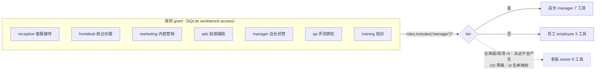
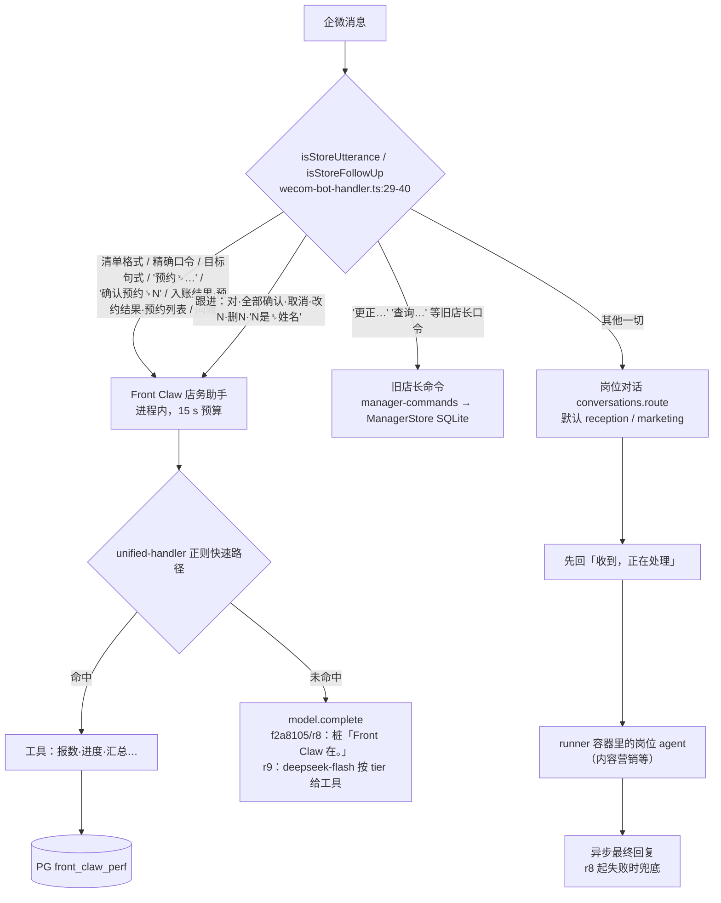
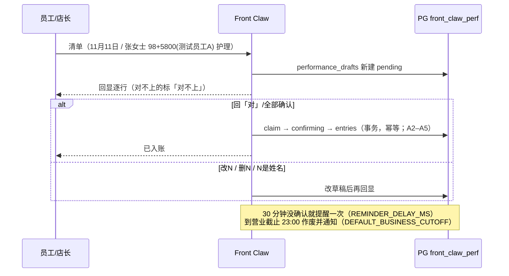
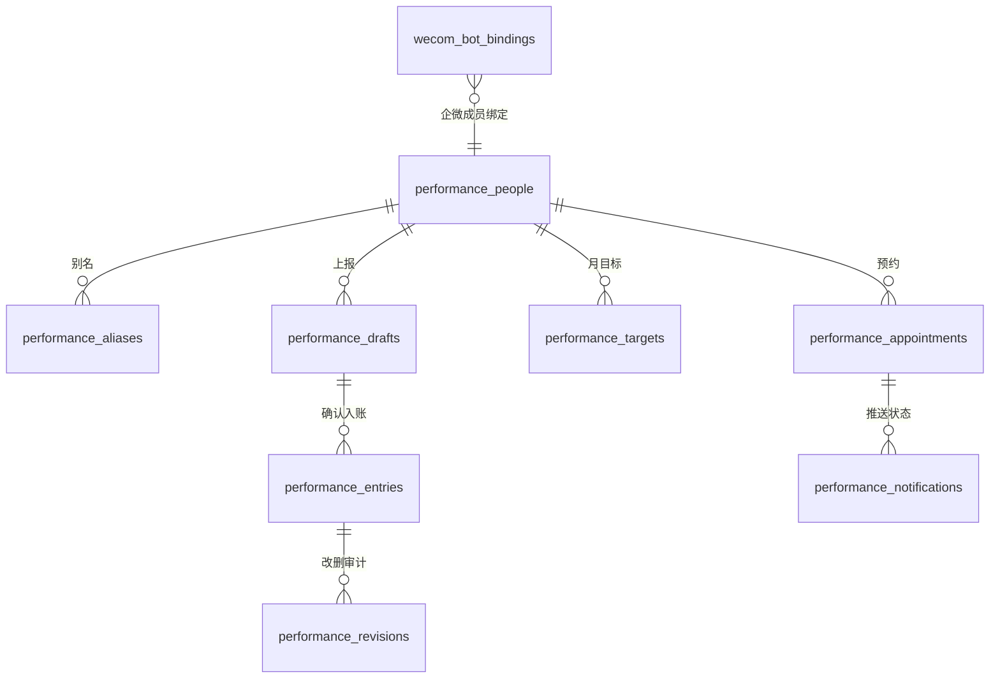

# Front Claw 产品架构（助手A侧，PRODUCT-ARCH.md）

> 编写：2026-11-10 北京时间（UTC+8）。只读整理：没有连服务器，没有读 env 或凭据，没有提交。
>
> **依据**
> - 源码：`<本地路径>`，HEAD 是 `f2a8105`，工作区干净，也就是**仓库版**。
> - 现场版：在仓库版上叠加 C、E、r5–r9 补丁，marker 是 `d05d316c…`。补丁文件在 `E/step3-fix-*`。
> - 问题登记：`E/issue-register-20261110/PRODUCT.md`（PR-xx）、`DEV.md`（DV-xx）。
> - 老板能力：`E/productization-issues-20261110/OWNER-CAPABILITIES.md`。
> - 开发总结：`E/dev-summary-20261110/CODE-CHANGES.md`（助手A，编号 A1–J）和 `DEV-SUMMARY.md`（助手B）。
>
> 简写 `E/` = `<证据目录>/`。行号指仓库版 f2a8105，除非注明是 r9。
> 标注：**已证实**＝源码、日志或截图能直接对上；**推断**＝能解释现象，但没有核对；**未找到证据**＝本机上没有材料。

---

## 0. 一句话
Front Claw 是挂在企业微信「智能机器人」上的门店助手，管报数、确认入账、目标、预约、汇总、未报名单和提醒。
同一个机器人背后还有一套旧的「岗位 agent」：内容营销、客服接待等。现在的问题是：**店务说法只要不在白名单里，就会被岗位 agent（主要是内容营销）接走**（PR-01、PR-02）。

## 1. 版本演进（产品视角）

| 版本 | 时间（北京时间） | 改变的产品架构部分 | 为什么 | 现在在哪里 |
|---|---|---|---|---|
| 仓库前史 `2590fa5`…`f81fd91`（43 个提交） | 10-17 → 11-02 22:43 | 隔离企微身份桥、报数确认与查询、更正、汇总、Excel、任务；岗位对话 intake；11-01 自动选岗（`3818945`） | 建立旧「店长报数＋岗位 agent」底座 | **仓库**（已推送历史，来自 DEV-SUMMARY §1.1） |
| PR35 `941e891` | 11-02 22:09 | **所有企微消息先过同一个 Front Claw 助手**：报数解析、精确口令、工具、员工/店长/老板分级 | 把店务从岗位 agent 里拆出来 | 仓库（PR35，未合并） |
| `6febd2c` / `f99a8ca` / `867c179` / `95467af` | 11-02 22:20 → 11-03 17:03 | 账本落进 PG `front_claw_perf`；统一 handler 和旧报数 handler**并存** | 账本持久化；pilot 接 PG | 仓库 |
| A1 fix-three | 11-07 18:14 | 报数表走已打开的 store，不再路由到「内容营销」 | 「3500 一直在内容营销」 | 被 f2a8105 吸收（推断） |
| A2 / A3 | 11-07 19:20 / 21:34 | 确认只 claim 一次、不越过预算、员工不能设目标；超时可查、崩溃可恢复 | 丢回复、重复入账、卡在 confirming | 被 f2a8105 吸收（推断） |
| A4 / A5 | 11-07 21:45 / 11-08 13:58 | 预约事务化；**「确认预约 N」锁定在店长看到的那份列表上**；通知状态 sent / not_sent / unknown | 确认错单、通知被吞 | f2a8105 |
| A6 → **f2a8105**（PR35 head） | 11-08 14:21 | 产品逻辑不变，只对齐启动入口 | 现场入口不对 | **仓库，已推送，未合并** |
| 门禁 v0–v2、申请 v1–v4 | 11-08 15:37 → 11-09 15:2x | **产品无变化**（容器门禁，见 ENG-ARCH） | — | 现场（v4 apply，marker 1cb6f544） |
| F-B r1–r4 | 11-09 18:37–22:42 | 产品无变化（外层进 DB 网） | — | 现场 |
| r5 | 11-09 23:0x | 受控真实模式**不再回落到内存账本**；先开 store 再连企微 | 构造期抛错（DV-05 相关） | 现场 |
| r6 / r7 | 11-10 00:xx / 13:18 后 | 产品无变化（pg 依赖、到期幂等关闭） | — | 现场 |
| r8 | 11-10 14:xx | **runner 失败时给用户一次兜底「处理失败，请稍后重试。」**；`final_delivery` 计数 | 营销路径没有最终回复 | 现场 |
| r9 | 11-10 16:xx | **Front Claw 进程内回复由桩「Front Claw 在。」换成真模型 deepseek-flash**，工具按 tier 给 | 进程内回复是假的（DV-20） | 现场（marker d05d316c） |
| r9-reopen | 11-10 18:3x | 无（只是再开窗口） | 要用已封存的 r9 再测 | 现场脚本 |
| step4 / 窗口 A | 11-10 20:56 / 21:04 | 无（21 项验收与 PG 计数） | 验收 | 现场脚本；结果进 PR-01…24 |
| r10 草稿 | 11-10 17:40 后 | owner 映射：名单里的 id 提升为 owner | 「测试员工A也是老板」 | **只有补丁草稿，没上现场** |

## 2. 角色分级（tier）与岗位（role）

两套概念并存。

- **岗位（WorkbenchRole）**：`workbench-access.ts:4` 定义了 `reception, frontdesk, marketing, ads, manager, qa, training` 七个，中文映射见 `wecom-bot-conversations.ts:17`（客服接待、前台办理、内容营销、投放辅助、店长经营、评测质检、培训）。每个岗位对应一个对话 workspace，执行在 runner 容器里（ENG-ARCH §4）。（已证实）
- **分级（tier）**：只看授权里有没有 `manager`。没有 owner 枚举（`wecom-bot-handler.ts:127`，r10 CHANGES 同此）。**老板目前不存在**（PR-06，已证实）。
- **工具（`wecom-bot-unified-handler.ts:69-74` toolsFor）**：

| 工具 | 员工 | 店长 | 老板（接入后） | 范围 |
|---|---|---|---|---|
| report_numbers 报数 | ✔ | ✔ | ✔ | 本店；可以替本店同事代报 |
| my_progress 我的进度 | ✔ | ✔ | ✔ | 本人 |
| submit_appointment 登记预约 | ✔ | ✔ | ✔ | 本人、本店 |
| get_summary 汇总/快照 | ✘ | ✔ | ✔ 但**只看本店** | 没有门店参数 |
| unreported 未报名单 | ✘ | ✔ | ✔ 只看本店，**不含老板本人** | |
| set_target 设目标 | ✘ | ✔ 本店 | ✔ **跨店** | |
| confirm_appointment 确认预约 | ✘ | ✔ | ✔ 只看本店 | |
| stores_ranking 门店排名 | ✘ | ✘「只有老板能看」 | ✔ **老板独有** | PG 里有人员的门店 |

（OWNER-CAPABILITIES §1，已证实源码，并做过离线模拟；**真实环境里没测过老板**。）

### 2.1 老板最后能看什么（PR-06、PR-07）
- **接入以后能用**：全部 8 个工具。真正跨店的只有「门店排名」和「给任意门店的人设目标」。另外会收到本店推送（预约待确认、改删金额、「（评测原句已删）」争议），前提是 PG 人员表里她的 tier 是 manager 或 owner（`unified-handler:180-183`）。
- **还看不到**：其他门店的汇总和未报名单（不能发「汇总 B店」）；跨店明细和按区间的报表；导出和文件（功能关闭，`assistant-commands.ts` 的 `isClosedCommand`）；旧 SQLite 账本里的数据（PR-09）。
- **要让老板能看，迁移里要做的**：tier=owner 加可见门店集合；汇总、未报、确认预约加门店参数；自然语言先进 Front Claw；只留一套 PG 账本（OWNER-CAPABILITIES §3）。测试员工A的企微 accountId 和 memberId：**未找到证据**，本机上只有脱敏值。

## 3. 功能域与流程

### 3.1 消息分流（现状：仓库版 f2a8105 与现场 r9 相同，r9 只改了模型）

- **白名单**（已证实，`wecom-bot-handler.ts:29-40`，`assistant-commands.ts`）：
  - 精确口令：我的进度、今天进度、进度、谁还没报、今天谁没报、**门店排名**、**各店排名**、汇总、今日汇总、快照、今日快照；
  - 目标句式：`…目标 数字[万千w]`；
  - 预约：`^预约(\s|$)`、`^确认预约\s+(序号|id)`；
  - 问候：你好、您好、在吗、hi、hello。
- **窗口 A 实测**（PR-01）：13 条消息里，Front Claw 处理 6 条，营销 6 条，旧命令 1 条。掉进营销的有：
  - 「门店排行」：同义词不认；
  - 「今天张女士护理 3800」：自然语言报数；
  - 「预约张女士…」：预约后面没空格；
  - 「确认预约」：没带序号；
  - 「今天店里怎么样」：闲聊（PR-02）；
  - 朋友圈请求：这条本来就该走营销。
- **「更正」被旧命令截获**：`manager-commands.ts:10` 的 `^更正` 先于 Front Claw 匹配（PR-05）。
- **姓名跟进句式不一致**：门禁要求 `N是␠姓名`，unified-handler:64 却接受没有空格的写法，按提示原样回复会被放走（PR-04）。

### 3.2 报数 → 确认 → 入账

- 金额改动和删除写进 `performance_revisions`，并推送给本店店长（unified-handler:268）。
- **缺口**：
  - 自然语言报数不进流程（PR-01）；
  - 没有草稿时回「对」会被误读（PR-10）；
  - 清单要求全量重报（PR-11）；
  - 提醒和作废依赖进程在线，试点窗口只有 30 分钟，根本跑不到 23:00（PR-14）；
  - 窗口 A 里员工名全部对不上，原因是 PG 人员表只有她 1 人，而且 displayName 为空（PR-03，已证实）。

### 3.3 目标、预约、汇总、未报、闲聊

| 功能 | 现状流程 | 缺口 |
|---|---|---|
| 目标 | 「本月目标 5w」**直接写入** `performance_targets`，没有确认（窗口 A 已证实） | 应该改成回显再确认（PR-08）；回复里没有人名（PR-03） |
| 预约 | 「预约 ␠姓名 时间 项目」→ 员工确认 → `performance_appointments` pending_manager → 店长「预约列表」→「确认预约 N」→ 推送给预约人 | 必须带空格和序号（PR-01）；推送观测不到（PR-13） |
| 汇总/快照 | 店长看本店：今天按人金额、本月完成率 | 老板不能指定门店（PR-07） |
| 未报名单 | 本店 employee 和 manager 里今天没报的 | 窗口 A 只显示标题加一行空行（PR-03） |
| 门店排名 | 老板独有 | 现在没有老板（PR-06） |
| 闲聊 | 只有问候进 Front Claw，r9 起是真模型；其他闲聊进营销 | PR-02 |
| 朋友圈/文案 | 走岗位「内容营销」，窗口 A 没有编价格（第 17 项实测过） | 这一项本来就该走营销 |

## 4. 数据对象

| 存储 | 对象 | 位置 | 说明 |
|---|---|---|---|
| **PG**（新账本） | `front_claw_perf` 下 10 张表：people、aliases、drafts、entries、revisions、targets、appointments、notifications、config、wecom_bot_bindings | `migrations/007_front_claw_perf.sql`；现场库 `legacy_appointment_db`，容器 `legacy-shared-pg-20261008-r1`（PR-18） | 窗口 A 之前各表全量为 0；窗口 A 写进 drafts 1 条、targets 1 条。清理要用户另批 |
| SQLite（旧账本） | ManagerStore 报数与更正 | 推断在运行卷 `manager/reports.sqlite`（DV-19） | 和 PG 不互通（PR-09）；删卷后很可能已经没了（推断） |
| SQLite | 岗位授权 grants | `frontagent-workbench-access.sqlite`（r10 CHANGES） | tier 的来源 |
| SQLite | 底座会话、任务、router_state | 底座 schema 69（DEV-SUMMARY §1.3） | 迁移到 OpenDot 时 69 要改到 107 |

## 5. 现状和目标的差距（交迁移计划）

| 领域 | 现状（现场 r9） | 目标 | 编号 |
|---|---|---|---|
| 入口 | 正则白名单，其他进营销 | 意图识别先进 Front Claw，营销只做兜底；同义词和容错 | PR-01、PR-02、PR-04、PR-05 |
| 身份 | tier 只有两档；测试账号资料为空 | tier=owner 加可见门店；资料不完整就拒绝启用 | PR-03、PR-06、PR-12 |
| 老板 | 不存在 | 8 工具，汇总、未报、确认可以跨可见门店 | PR-07 |
| 账本 | PG 和 SQLite 两套 | 只用 PG；旧数据先确认还在不在 | PR-09、DV-19 |
| 确认语义 | 目标直接写入；无草稿时「对」会误读 | 目标也回显确认；「对」要有上下文 | PR-08、PR-10、PR-11 |
| 回复 | 营销路径异步，顺序会乱 | 按提问顺序回复，或者引用原问题 | PR-15 |
| 推送和提醒 | 观测不到；依赖进程在线 | 服务端常驻调度，逐条落日志 | PR-13、PR-14、PR-17 |
| 模型 | 失败时整窗 STOP | 降级回复加重试 | PR-16、DV-21 |
| 验收 | 单账号；清单里留了占位符 | 多员工合成测试；清单只给能直接复制的原文 | PR-19、DV-28 |

## 6. 证据缺口
- 测试员工A的 accountId / memberId、可见门店：**未找到证据**。
- displayName 为什么是空的：**推断**（PR-03），没有做 `length(display_name)=0` 的只读核对。
- 「推送真的送到了」：没有服务端逐条日志，**未找到证据**（DV-29）。
- 旧 SQLite 账本的实际路径和内容：**未找到证据**（DV-19）。
- PR35 一共 6 个提交，本文只列了 DEV-SUMMARY 给出的 5 个，第 6 个的提交号和时间：**未找到证据**（本次没有联网读 PR）。
