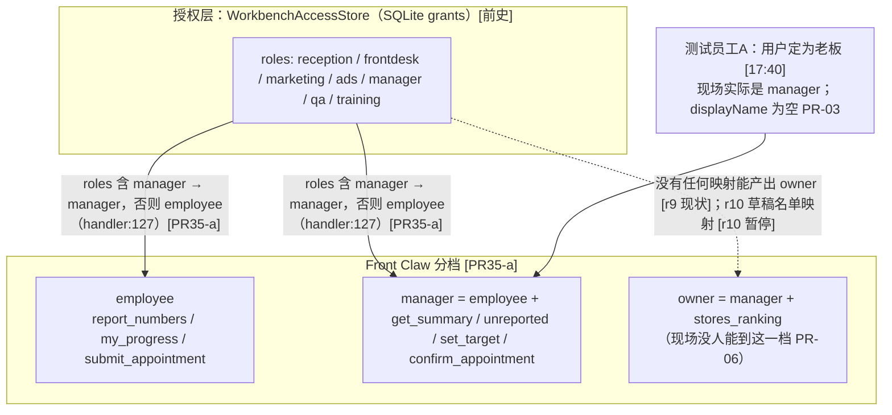
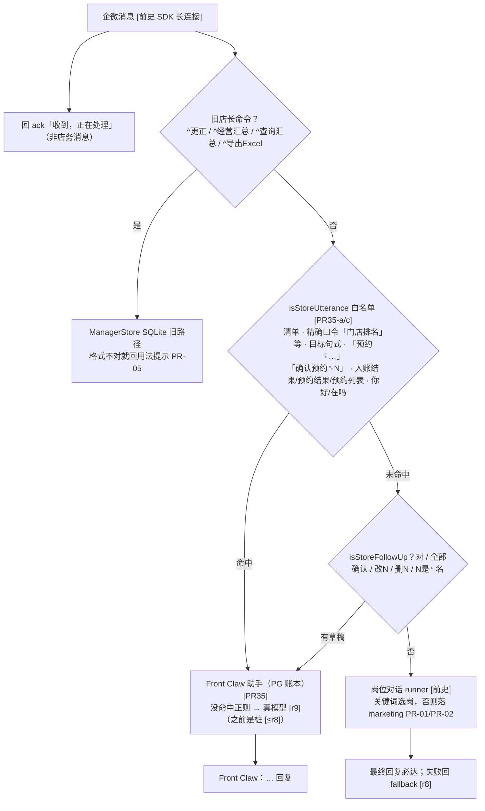
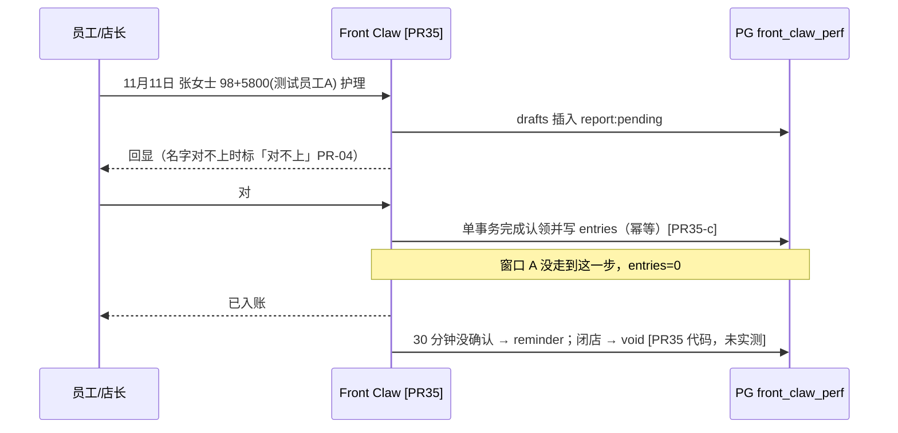
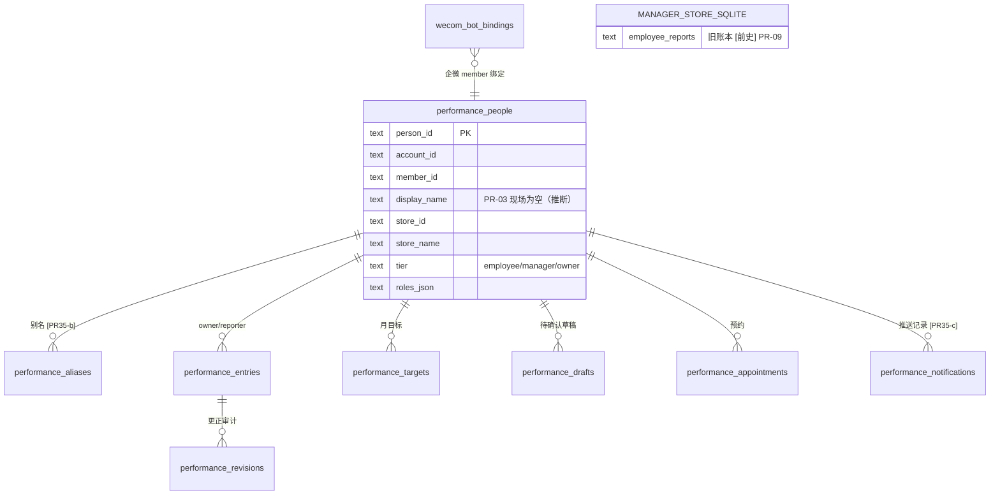

# Front Claw 产品架构（助手B视角，截至 2026-11-10 22:15 UTC+8）

> 依据：用户 22:09 原话「还有产品架构和工程架构呢」「你和助手B都要」，22:10 原话「把每个版本迭代这两份也要标记出来」，均由助手A转述。
> 编写方式：全程只读，没连服务器、没读 env、没 sudo、没改已有文件、没提交、没开窗。时间为北京时间（UTC+8）。
> 路径简写：`E/` = `<证据目录>/`；`R/` = `<本地路径>`，即 `f2a8105` 的只读浅克隆，与现场 stage 中未被 r5–r9 改动的文件一致（依据 `E/step3-live-r9-bundle-20261110/task/CHANGES-r9.md` 的 UNTOUCHED 段）。
> 来源标签：
> - 【文件】本机上的文件，给出路径
> - 【GitHub】GitHub 只读接口
> - 【会话记录】助手A的会话记录，没有时间戳
> - 【仅记忆】只有助手B的记忆或任务清单
> - 【推断】
> - 【无证据】
> 问题编号：引用 `E/issue-register-20261110/` 当前版本（tgz `4b403fb9…`）里的 PR-01…PR-24 和 DV-01…DV-34。

---

## 1. 版本演进表（产品视角）

| 版本 | 时间（UTC+8） | 产品架构哪一块变了 | 为什么变 | 现在在哪 |
|---|---|---|---|---|
| **前史** 2590fa5…c86601d | 10-17 → 11-01（git） | 隔离版企微：身份桥接、报数确认、汇总/Excel、任务、对话与岗位工作区（客服、前台、内容营销等 7 个岗位）。11-01 起叫 Front Claw，绑定身份后自动选岗 | 先把原 Frontagent 的员工岗位接进企微 | 仓库已推送（origin 各分支）【文件：`<本地路径>` git log】 |
| **PR35-a** 941e891 / 6febd2c / f99a8ca / 867c179 | 11-02 22:09–22:58 | 新增**统一 Front Claw 助手**。店务口令（报数、进度、目标、预约、汇总、未报、排名）先走助手，其余仍走岗位对话；分三档 employee/manager/owner，各档工具不同；账本放进 PG `front_claw_perf` | 一个机器人同时承担店务和岗位对话 | 已推送，PR #35 open，未合并【GitHub】 |
| **PR35-b** 95467af | 11-03 17:03 | 员工目录、别名迁入 PG（`directory-store.ts`），多员工 | 接 PG，重启后数据不丢 | 已推送【GitHub】 |
| **PR35-c** f2a8105 | 11-08 14:21 | 草稿认领在一个事务里完成，入账幂等；「确认预约 N」锁定店长已看到的列表；通知状态与业务提交分开记录 | 防止重复入账、确认错客人 | 已推送，是 PR head；11-08 15:19 同步到现场 stage 并封存【GitHub；`E/stage-preparation-completed-20261108.json`】 |
| OpenDot 方案 | 约 11-06（画布标题日期） | 目标底座改为 OpenDot：role-eval 原样复用，企微保留 SDK 直连，本期关 Mem0 | 底座代码 167/198 相同，搬迁比在旧底座上对齐更省事 | 只是方案，未执行【会话记录】 |
| astra 审查 | 11-07 17:51–17:52（推断，依据 mtime） | 给迁移补了 6 个放行门槛；21 项验收门槛的原文就在这里 | 计划缺影子回放隔离、回滚一致性等 | 文件 `<本地路径>`、`review.txt` |
| 门禁 v1→v4 | 11-08 17:06 → 11-09 16:30 | **产品行为不变**，只是让试点能启动 | 见工程文档 | v2 已应用到现场 stage（marker 1cb6f544），未进 git |
| F-B r1–r4 | 11-09 18:32 → 19:19 | 产品行为不变（DB 网络接法） | 同上 | r4 应用到 stage，未进 git |
| r5 | 11-09 23:12 | 受控真实模式下，**先开账本再连企微**；不再回落到内存账本 | 不这样做账本根本打不开（DV-05、DV-06） | stage，未进 git |
| r6 / r7 | 11-10 00:22 / 13:29 | 不变（依赖、关闭逻辑） | — | stage |
| **r8** | 11-10 14:26 | 所有消息都**保证有最终回复**；runner 失败时统一回「处理失败，请稍后重试。」 | r7 窗口里用户收到 ack 后没有下文 | stage |
| **r9** | 11-10 16:17 | Front Claw 自由对话从**桩**「Front Claw 在。」换成**真模型** deepseek-flash；工具按档：员工 3、店长 7、老板 8 | 用户要能真正聊天 | stage，当前封存 d05d316c |
| r9-reopen | 11-10 18:44 | 产品不变，可以重复开测试窗口 | — | 本机包，现场复用 |
| **step4 窗口 A** | 11-10 21:04–21:34 | 产品不变；第一次按 21 项**实测** | 验收 | 证据 `E/step4A-live-20261110/`；问题登记 issue-register |
| r10（已暂停） | 11-10 17:44 | 测试员工A = owner 映射 | 用户 17:40「测试员工A也是老板」 | 只是本机草稿，用户 20:28 决定暂停 |

---

## 2. 角色分层

| 档位 | 能做什么 | 数据范围 | 现状 | 来源 |
|---|---|---|---|---|
| 员工 | 报数（回显后回「对」才入账）、我的进度、登记预约 | 本人、本店 | 代码有；窗口 A 只有她一个账号，测不了员工身份 | 【文件】`E/productization-issues-20261110/OWNER-CAPABILITIES.md` §1；PR-19 |
| 店长 | 员工的全部功能，再加汇总、谁还没报、设目标、确认预约 | **只限本店** | 测试员工A现场是这一档（r5 证据显示她的 roles 含 manager） | 【文件】OWNER-CAPABILITIES 开头；`R/src/role-eval/wecom-bot-handler.ts:127` |
| 老板 | 店长的全部功能，再加门店排名（全部门店）、给任意门店的人设目标 | 汇总、未报、确认预约仍只限本店 | **现场不存在**（PR-06）；能力只在代码里，最终能看到的范围见 PR-07 | 【文件】OWNER-CAPABILITIES §1–3；`E/step3-live-r10-bundle-20261110/task/CHANGES-r10.md` |

测试员工A的现状：
- **身份：** 用户 17:40 原话「测试员工A也是老板，开跑」【仅记忆/会话记录】。现场仍是店长。r10 映射需要她的 accountId 或 memberId，用户还没提供【文件：CHANGES-r10.md「PENDING」】。
- **PR-03（P0）：** 她的 displayName 为空，所以目标回复里没有人名，「谁还没报」只有一行空名，店名也是空的。根因：
  - **已证实：** 回复模板会直接用空的 displayName。
  - **推断：** 来源是 `business.employees[0].employeeName` 为空。
  - **待核：** 一次只读 PG 核对（`length(display_name)=0`），还没做。
  - 依据：【文件】`E/issue-register-20261110/PRODUCT.md` PR-03；窗口 A 的 PG 计数为 `people|stores|1`、`people|tier=manager|1`（`E/step4A-live-20261110/step4A-pg-2after.log`）。

---

## 3. 岗位与智能体

| 智能体/岗位 | 承担什么 | 实现位置 | 版本 | 现场实证 |
|---|---|---|---|---|
| **Front Claw 助手**（进程内） | 店务口令、问候；没有命中正则时调模型 | `wecom-bot-unified-handler.ts`、`assistant-tools.ts`、`wecom-bot-pilot.ts` 中的 `createFrontClawModel` | PR35-a 起；r9 换真模型 | 窗口 A：`front_claw_handled=6`、`model_call=1 ok=1`；「你好」得到真模型问候（截图 S7）【文件：`E/step4A-live-20261110/step4A-04-residue.log`；PRODUCT.md】 |
| **岗位对话**：内容营销 marketing，另有客服、前台、投放、质检、培训、店长经营 | 经 runner 容器跑原 pi agent；按关键词选岗位，没命中时依次落到 reception、marketing、第一个已授权岗位 | `wecom-bot-conversations.ts:17-26,196` | 前史 | 窗口 A：`conv_batch_start=6`，runner 6 轮全部送达 |
| 旧店长命令 | `更正`、`经营汇总`、`查询汇总`、`导出Excel` | `manager-commands.ts` 加 ManagerStore（SQLite） | 前史 | 「更正 1800」被截走，回了旧用法提示（PR-05） |

【推断】测试员工A的授权里没有 reception，所以没命中关键词的话都落到 marketing，这能解释 PR-01、PR-02。依据是 `wecom-bot-conversations.ts:26` 的兜底顺序；她的完整 roles 清单【无证据】。

---

## 4. 路由规则（r9 现状）

- 白名单正则：【文件】`R/src/role-eval/wecom-bot-handler.ts:29-40`。
- 旧命令：【文件】`R/src/role-eval/manager-commands.ts`。
- 规则顺序是**推断**：旧命令先于 Front Claw 处理。依据是现象（PR-05）和 PRODUCT.md 的根因说明。
- 窗口 A 实测落到营销的说法有：门店**排行**、无空格的「预约张女士…」、不带序号的「确认预约」、自然语言报数「今天张女士护理 3800」、「今天店里怎么样」（PR-01，P0；PR-02）。
- 跟进句式不一致：提示文字是「1 是姓名」，正则却要求「是」后面有空格（PR-04）。

---

## 5. 功能域与流程

| 功能域 | 流程（代码） | 窗口 A 实测 | 编号 |
|---|---|---|---|
| 报数 | 清单解析后回显，草稿存 PG drafts，员工回「对」才入账；草稿认领在单事务里完成，入账幂等 [PR35-c] | 拆行正确；名字对不上（PR-03，测试中照抄了 `<名字>`，DV-28）；drafts +1，entries 0 | PR-03、PR-04、PR-11 |
| 自然语言报数 | 不在白名单里，落到营销 | 实测不过（第 13 项） | PR-01 |
| 确认（「对」） | 依赖已有草稿；没有草稿时会被误读 | 未测 | PR-10 |
| 更正 | 被旧命令截走 | 实测不过（第 12 项） | PR-05 |
| 目标 | 句式识别后**直接写入** targets，没有确认步骤 | 「本月目标 5w」写入 50000；回复里没有人名 | PR-08、PR-03 |
| 预约 | `预约 ␠…` 登记为 pending_manager，店长「预约列表」后「确认预约 N」，再推送给预约人 [PR35-c] | 都因原文偏差落到营销；appointments 0 | PR-01、PR-13 |
| 汇总 / 未报 / 排名 | 汇总和未报只看本店；排名只有老板能看 | 「谁还没报」只有标题加一行空名；汇总未测；排名发成了「排行」 | PR-03、PR-06、PR-07 |
| 提醒 / 作废 | 进程内维护计时器，默认每 90 秒扫一次草稿的 reminder/void（`wecom-bot-pilot.ts:36`） | 未测（窗口 B 取消） | PR-14 |
| 闲聊 | 只有问候能进 Front Claw，其余落到营销 | 「今天店里怎么样」落到营销；用户判不过 | PR-02 |
| 朋友圈文案 | 落到营销岗（关键词「朋友圈」） | 实测过，没有编造价格 | — |

---

## 6. 数据对象

- **PG 表：** 共 10 张，在 schema `front_claw_perf` 下，另有 `performance_config`（迁移脚本 `R/migrations/007_front_claw_perf.sql`）【文件】。门店没有单独的表，以 `store_id`/`store_name` 字段存在。manager 不是一张表，是 `tier` 字段的取值。
- **两套账本（PR-09，P0）：** Front Claw 用 PG，旧店长命令用 ManagerStore 的 SQLite（`employee_reports`，`R/src/role-eval/manager-store.ts:87`），两边不互通。删卷后旧 SQLite 很可能已经丢了【推断，DV-19】。
- **授权：** roles 存在另一个 SQLite（`frontagent-workbench-access.sqlite`）【文件：CHANGES-r10.md】。
- **现场库：** `legacy_appointment_db`；窗口 A 后 people 有 1 人（manager），drafts 和 targets 各有 1 条测试数据，还没清理（PR-18）【文件：step4A-pg-2after.log】。

---

## 7. 现状与目标态差距

| 方面 | 现状（r9 现场） | 目标态（迁移计划） | 编号 | 来源 |
|---|---|---|---|---|
| 意图路由 | 正则白名单，其余落营销 | Front Claw 先识别意图，营销只做兜底；支持同义词和容错 | PR-01、PR-02、PR-04 | PRODUCT.md |
| 旧命令 | `^更正` 等截走 | 下线，或给 Front Claw 让路 | PR-05 | 同上 |
| 老板 | 没有 | tier=owner，加可见门店集合；汇总、未报、确认预约支持跨店 | PR-06、PR-07 | OWNER-CAPABILITIES §3 |
| 身份完整性 | displayName 为空也能启用 | 为空时拒绝启用，并给候选名单 | PR-03 | PRODUCT.md |
| 目标 | 直接写入 | 先回显，回「对」再写 | PR-08 | 同上 |
| 降权 | 没有机制 | 下一条消息立即生效 | PR-12 | 同上 |
| 账本 | PG + SQLite | 只保留 PG | PR-09 | 同上 |
| 回复 | ack 加异步回复，顺序会乱 | 每条消息一条最终回复，并引用原问题 | PR-15 | 同上 |
| 推送/提醒 | 观测不到；依赖进程在线 | 服务端落日志；调度可恢复 | PR-13、PR-14 | 同上 |
| 时延 | 15 秒没有逐条记录 | 服务端逐条记录时间戳 | PR-17、DV-29 | 同上 |
| 记忆 | Mem0 仍在运行 | 下线（计划 d3669097，未执行） | PR-22 | `E/mem0-decom-plan-20261110/PLAN.md` |
| 迁移放行 | 21 项：过 2、不过 5、无效 7、未测 7 | 21 项全过，并满足 astra 审查的 6 个门槛 | ISSUE-REGISTER §3 | `<本地路径>` |

---

## 8. 无证据或推断清单（产品）

1. 测试员工A的完整 roles、accountId 和 memberId【无证据】（本机上只有脱敏值）。
2. 旧命令先于白名单处理的精确调用顺序【推断】，没有逐行核对 handler 的分派代码。
3. 没命中关键词时落到 marketing，前提是她没有 reception 授权【推断】。
4. displayName 为空的数据源【推断】；删卷后旧 SQLite 丢失【推断】。
5. 「Front Claw 产品×架构对齐」群的评审回复【无证据】。
6. 21 项的原始编号来自 astra 审查输入；没有正式的带编号原文【文件：ACCEPTANCE-21.md 第 25 行说明】。
